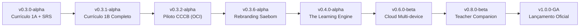

# Saebom Companion (새봄 컴패니언) — Master Design & Neuroscience Specification

## 1. Brand Essence & Pedagogical Philosophy

### A. The Identity
**Saebom Companion (새봄 컴패니언)** is an academic digital study companion engineered for adult Lusophone students learning Korean at the Centro Cultural Coreano no Brasil (CCCB). The name pairs:
* **새봄 (Saebom):** *New Spring* (`새` = new/renewed, `봄` = spring). It signifies the intellectual awakening that unfolds when learning a new language.
* **Companion:** A steadfast, respectful presence that supports retention between classroom sessions.

> **The Pedagogical Golden Rule:**  
> *"Technology accompanies pedagogy. It never competes with it."*  
> The application serves as an out-of-classroom fixity companion; never as a parallel school or a replacement for the professor.

### B. Inviolable Brand Directives & Invariants
1. **Strict Prohibition of the Name "Sejong":** By explicit directive from the course professor, the name "Sejong" is strictly deprecated and prohibited across all new views, screen titles, components, and documentation. The official name is **Saebom Companion (새봄 컴패니언)**.
2. **Spring as Metaphor, Never as Literal Decoration:** The spring (*새봄*) represents cognitive renewal and intellectual blossoming through discipline. It is strictly forbidden to use literal cherry blossoms (🌸), anime tropes, or cartoonish K-pop styling.
3. **Nocturnal Study Desk Atmosphere:** Zero juvenile gamification (no candy lives, casino sparkles, or hyperbolic claims of effortless 15-day fluency). The UI feels like a clean, quiet late-night library desk: focused, dignified, and serene.

---

## 2. Chromatic Architecture (60 / 20 / 12 / 8)

The visual design is governed by the Brand Book v3.1 chromatic ratio:

```
┌────────────────────────────────────────────────────────┐
│  Navy is Territory. Violet is System. Gold is Signal.  │
└────────────────────────────────────────────────────────┘
```

* **Navy is Territory (60% — `#02060F`):** Deep, distraction-free nocturnal ground that eliminates eye fatigue during late-night study. Elevated surfaces tier cleanly into `#0B132B` (Midnight Surface) and `#151E3D` (Elevated Container).
* **Reading & Structure (20% — `#F7F4EC` Cream & `#9EA2AE` Slate):** Cream provides parchment-like warm contrast for all text, avoiding sterile white. Slate provides structural hierarchy, secondary metadata, and 1px hairline separators.
* **Violet is System (12% — `#8B4DFF` Primary & `#B28AFF` Lilac):** Governs structural navigation, progression indicators, interactive active states, and system feedback.
* **Gold is Signal (8% — `#FFAB22` Accent):** Strictly reserved for high-value milestone actions, mastery badges, and primary confirmation CTAs (e.g., **"✅ Terminei"**).

### Pedagogical Domain Color Mappings

| Domain Function | Color Token | Hex Code | Visual & Neurological Meaning |
|---|---|---|---|
| **SOV Subject (주어)** | `role-subject` | `#3B82F6` | Academic Blue — Identifies the topic/subject agent |
| **SOV Object (목적어)** | `role-object` | `#00E699` | Emerald Jade — Target of the grammatical action |
| **SOV Verb / Predicate (서술어)** | `role-verb` | `#8B4DFF` | Electric Violet — Action or descriptive state |
| **SOV Particles (조사)** | `role-particle` | `#FFAB22` | Celestial Gold — Grammatical connectors (`은/는`, `이/가`, `을/를`) |
| **Phonetic Lax (평음)** | `occlusive-lax` | `#9EA2AE` | Slate Neutral — Calm baseline articulation (`ㄱ`, `ㄷ`, `ㅂ`, `ㅅ`, `ㅈ`) |
| **Phonetic Aspirated (격음)** | `occlusive-aspirated`| `#38BDF8` | Sky Blue — Expansive air burst (`ㅋ`, `ㅌ`, `ㅍ`, `ㅊ`) |
| **Phonetic Tense (경음)** | `occlusive-tense` | `#FF4D6D` | Glottal Crimson — Vocal chord tension (`ㄲ`, `ㄸ`, `ㅃ`, `ㅆ`, `ㅉ`) |
| **SRS Retention High** | `vitality-high` | `#00E699` | Memory stability $\ge 75\%$ (Strong synaptogenesis) |
| **SRS Retention Medium** | `vitality-medium` | `#FFAB22` | Review approaching ($35\% \le R < 75\%$) |
| **SRS Retention Critical**| `vitality-low` | `#FF4D6D` | Forgetting curve inflection point ($R < 35\%$) |

---

## 3. Cognitive Neuroscience & Implicit Learning Engine

The application embodies principles derived from didactic neuroscience and cognitive science for Lusophone adults:

### A. Implicit Learning (Zero Textual Disclaimers)
* **Principle:** Banners explaining rules (e.g., *"Why we don't use romanization"*, *"Grammar tips"*) are completely banned.
* **Mechanism:** Pedagogical constraints are enforced via **Physics Gating** (magnetic snapping, spring repulsion on illegal syntactic sequences, and audio-visual gating).

### B. Mathematical Memory Decay (Half-Life SRS)
* Memory retention follows the temporal half-life model:
  $$R(t) = 2^{-\frac{t}{h}}$$
  where $t$ is the elapsed time since last review and $h$ is the synaptic stability half-life.
* Thresholds:
  * $R \ge 0.75$: Mastered (Green `#00E699`).
  * $0.35 \le R < 0.75$: Review Due (Gold `#FFAB22`).
  * $R < 0.35$: Critical Decay (Crimson `#FF4D6D`).

### C. Sensory Quick Wins & Haptics
* **Vibration API / Haptic Feedback:** Subtle single pulse on successful placement; gentle double vibration on illegal syntax attempts.
* **Juicy Snap Animation:** Satisfying micro-scaling and elastic snap when a grammatical block enters its target slot.
* **Air Particle Burst (`AirParticleEffect`):** Visual acoustic air burst radiating outwards exclusively for aspirated consonants (`ㅋ`, `ㅌ`, `ㅍ`, `ㅊ`).

---

## 4. Interactive Neuroscience Mechanics (Branch Features)

### A. Fábrica de Sílabas (Syllable Factory & Batchim Seal)
* **Function:** Teaches the fundamental orthographic structure of Hangul syllables:
  $$\text{Syllable} = \text{Initial (초성)} + \text{Medial (중성)} \;[+ \text{Batchim (종성)}]$$
* **Visual Mechanics:**
  * Initial consonant slot (`#3B82F6` Blue).
  * Medial vowel slot (`#FFAB22` Gold).
  * Batchim base slot (`#00E699` Jade).
  * **Batchim Seal:** A tactile visual stamp indicating that the final consonant must be confined to the bottom-third of the cell to achieve orthographic balance.

### B. Palco Espacial de Partículas de Lugar (Spatial Stage)
* **Function:** Eliminates confusion around spatial locatives (`위` em cima, `아래` embaixo, `앞` na frente, `뒤` atrás, `안` dentro, `밖` fora) and locative particles (`에/에서`).
* **Visual Mechanics:**
  * 2D isometric stage featuring minimal vector assets: Table (`책상`), Chair (`의자`), Book (`책`), Bag (`가방`), and Dog (`강아지`).
  * The student drags the target item to the designated spatial anchor. Upon correct placement, the sentence auto-completes: *"책이 책상 위에 있어요"*.

### C. Treinador de Números Coreanos (Dual-System Dialpad)
* **Function:** Addresses the major friction point of Korean numerals:
  1. **Sino-Coreano (일, 이, 삼, 사...):** Used for telephone numbers, dates, currency, minutes, bus lines.
  2. **Nativo-Coreano (하나, 둘, 셋, 넷...):** Used for counting objects, age, hours, people.
* **Visual Mechanics:**
  * Retro-academic phone dialpad interface.
  * Context toggle between Sino and Native modes with immediate acoustic feedback and digit mapping.

### D. Guia Anatômico de Articulação Labial (Mouth Shapes)
* **Function:** Visual guides demonstrating lip and jaw posture for the 6 cardinal vowels (`ㅏ`, `ㅓ`, `ㅗ`, `ㅜ`, `ㅡ`, `ㅣ`).
* **Contrast Pairs:** Highlights the subtle acoustic difference between `ㅓ` (open unrounded vowel) and `ㅗ` (rounded closed vowel) to prevent Portuguese native phonetic interference.

### E. Laboratório Fonético de Tripartição Oclusiva (VOT / Acoustic Lab)
* **Function:** Visualizes Voice Onset Time (VOT) in milliseconds for stop consonants:
  * Lax `ㄱ` ($\approx 30\text{ ms}$ VOT) — Low acoustic tension.
  * Aspirated `ㅋ` ($\approx 90\text{ ms}$ VOT) — Long delay with turbulent air burst.
  * Tense `ㄲ` ($\approx 15\text{ ms}$ VOT) — Pre-glottal constriction with immediate vowel onset.

---

## 5. Typography & Anti-Tofu Invariants

Cross-platform CJK rendering requires strict typeface pairing:

1. **Global Interface Baseline: `Pretendard`**
   * Variable optical weight designed natively for simultaneous Korean Hangul (`U+AC00` to `U+D7A3`) and Latin character balance.
   * Prevents glyph rendering collapse (*tofu* `□□□□`) across Flutter Web (CanvasKit), iOS, Android, and Desktop.
   * Line-height maintained at $1.4\times$ to $1.5\times$ to prevent Hangul stacking syllable collisions.
2. **Calligraphy & Manuscript Canvas: `Kyobo Handwriting 2025`**
   * Authentic, human stroke rhythm and natural ligatures.
   * Reserved strictly for the manuscript grid (원고지) guide templates to instruct genuine brush/pen stroke order.

---

## 6. Layout, Spacing & Viewport Ergonomics

* **Base Grid Unit:** Strict 4px scale ($4, 8, 16, 24, 32, 48\text{ px}$).
* **Reading Containment:** Max-width clamped at `600px` (`max-content-width`). All exercise cards, reading blocks, and quizzes center comfortably within this column on tablets and desktops.
* **Touch Target Ergonomics:**
  * Minimum interactive height: `48px`.
  * Audio circular buttons: `44px` to `48px`.
  * Word chips wrap dynamically with an 8px gap (`space-sm`) to prevent horizontal viewport clipping.
* **Responsive Breakpoints:**
  * **Compact ($< 360\text{px}$):** Galaxy Fold closed (280px), iPhone SE (320px). Margins: 12-16px.
  * **Medium ($360\text{px} - 480\text{px}$):** Standard mobile devices. Margins: 16px.
  * **Expanded ($\ge 768\text{px}$):** Desktop & Tablets. 600px centered canal with 32px gutters.

---

## 7. Master Roadmap (From Alpha to GA)



### Milestone Breakdown

1. **v0.3.0-alpha (Content & Memory Baseline — Concluído):**
   * 11 unidades do Sejong 1A em JSON, modelo de meia-vida temporal e telemetria anônima.
2. **v0.3.1-alpha (Expansão 1B — Concluído):**
   * 12 unidades do Sejong 1B com exercícios do Workbook e cadeia contínua de desbloqueio.
3. **v0.3.2-alpha (Estabilização & Piloto CCCB — Ativo):**
   * Deploy 24/7 na Oracle Cloud com Caddy HTTPS, persistência SharedPreferences e auditoria com turmas reais.
4. **v0.3.6-alpha (Rebranding & Manual v3.1 — Concluído):**
   * Transição completa para **Saebom Companion**, Brand Book v3.1, paleta 60/20/12/8 e pretérito Sejong banido.
5. **v0.4.0-alpha (The Learning Engine — Meta Imediata):**
   * Implementação do pacote `src/engine/` com IA Simbólica / Cognitiva Local, grafo de dependência curricular atômico e predição de lacunas sinápticas.
6. **v0.6.0-beta (Nuvem Multi-device):**
   * Sincronização multi-plataforma transparente (PostgreSQL) mantendo capacidades offline-first.
7. **v0.8.0-beta (Teacher Companion):**
   * Portal exclusivo da docente do CCCB com telemetria agregada, mapa de calor de retenção da turma e agendamento de tarefas semanais.
8. **v1.0.0-GA (Produção Oficial):**
   * Aplicativo polido para Web, Android, iOS e Desktop com suporte offline integral.
