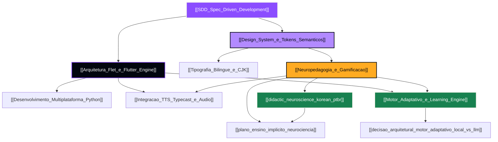

# 🧠 Central Mestre de Conceitos — Saebom Companion (새봄 컴패니언)

**Projeto:** Saebom Companion (Flet / Python + Flutter Engine)  
**Padrão de Documentação:** Obsidian Knowledge Graph (`[[Wikilinks]]` + Markdown Standard)  
**Última Atualização:** 2026-11-24  

---

## 🧭 Visão Geral e Mapa da Rede do Conhecimento

Esta central consolida os **fundamentos teóricos, arquiteturais, de engenharia de software, design system e neuropedagogia** que regem a construção do aplicativo **Saebom Companion (새봄 컴패니언)**.

Diferente de uma documentação estática, cada conceito aqui catalogado é um **nó ativo de conhecimento**, interconectado através de `[[Wikilinks]]` aos manuais de marca (`/Design_e_Branding`), planos de implementação (`/Planos_e_Arquitetura`), relatórios de pesquisa (`/Viabilidade_e_Pesquisa`), históricos (`/Changelogs_e_Historico`) e diagnósticos de bugs críticos (`/Bugs_Criticos`).

---

## 🗂️ Matriz de Conceitos Catalogados

### 1. 📐 Engenharia de Software e Metodologia
- 📄 **[[SDD_Spec_Driven_Development]]** — Desenvolvimento guiado por especificações rigorosas e contrato de tokens únicos (*Single Source of Truth* em `src/theme.py` alinhado ao Brand Book v3.1). Elimina estilização *ad-hoc*, valores mágicos e divergências visuais.
  - *Documentos Relacionados:* [[MANUAL_DE_IDENTIDADE_SAEBOM]], [[Plano_UIUX_Flet_Sejong_Companion]], [[implementation_plan]], [[analise_stack_multiplataforma]]

- 📱 **[[Desenvolvimento_Multiplataforma_Python]]** — Engenharia de aplicação nativa multiplataforma (Web PWA, Android APK, iOS Bundle, Desktop) a partir de uma única base de código em Python. Analisa binds locais no Windows (`127.0.0.1`), roteamento atômico e alocação de memória.
  - *Documentos Relacionados:* [[analise_stack_multiplataforma]], [[bug_06_bind_windows_flet_server_ip]], [[bug_11_tela_preta_flutter_web_assets_e_views_router]]

---

### 2. ⚙️ Arquitetura de Framework e Mídia
- ⚡ **[[Arquitetura_Flet_e_Flutter_Engine]]** — Estudo aprofundado da bridge Python-Flutter: WebSocket/JSON delta patch, CanvasKit/Skwasm, gerenciamento atômico de `page.views`, prefixo `/` absoluto para assets Web (`BUG-11`), timeouts assíncronos e layout de viewport (`scroll=ft.ScrollMode.AUTO`).
  - *Documentos Relacionados:* [[bug_01_flet_audio_corridas_e_page_services]], [[bug_04_bloqueio_de_scroll_listview_e_appbar]], [[bug_02_sintaxe_flet_085_letter_spacing_e_button_args]], [[bug_11_tela_preta_flutter_web_assets_e_views_router]]

- 🎙️ **[[Integracao_TTS_Typecast_e_Audio]]** — Arquitetura de síntese de voz natural em coreano (TTS Typecast.ai + fallback Google TTS), padrão Singleton `AudioService`, destravamento de autoplay Web com `assets/silent.wav` (`BUG-08`) e isolamento estrito entre `assets/` (*read-only*) e `data/cache/audio/` (mutável em runtime).
  - *Documentos Relacionados:* [[bug_01_flet_audio_corridas_e_page_services]], [[bug_08_politica_autoplay_navegador_e_silent_wav]], [[didactic_neuroscience_korean_ptbr]]

---

### 3. 🎨 Design System, Cores e Tipografia
- 🎨 **[[Design_System_e_Tokens_Semanticos]]** — Sistema cromático oficial do **Brand Book v3.1 (60/20/12/8)**: Midnight Navy (`#02060F`), Cream (`#F7F4EC`), Slate (`#9EA2AE`), Violet (`#8B4DFF` `PRIMARY`), Lilac (`#B28AFF` `SECONDARY`) e Gold (`#FFAB22` `ACCENT`), além de `ft.Colors.with_opacity()` e formato `#AARRGGBB` no Flutter Engine.
  - *Documentos Relacionados:* [[MANUAL_DE_IDENTIDADE_SAEBOM]], [[DESIGN_SYSTEM_CHANGELOG]], [[bug_03_inversao_hex_alpha_aarrggbb_flet_flutter]]

- 🔤 **[[Tipografia_Bilingue_e_CJK]]** — Engenharia tipográfica 100% local em `assets/fonts/` para o par Português ↔ Coreano: **Pretendard** (`Pretendard-Regular.otf`, `Pretendard-Bold.otf`) como fonte global da interface com prevenção absoluta de *tofu* (`□□□□`) e **Kyobo Handwriting 2025** (`KyoboHandwriting2025lyb.otf`) para caligrafia coreana no Wongoji Lab.
  - *Documentos Relacionados:* [[bug_07_flutter_font_fallback_tofu_hangul]], [[MANUAL_DE_IDENTIDADE_SAEBOM]], [[DESIGN_SYSTEM_CHANGELOG]]

---

### 4. 🧠 Neuropedagogia e Inteligência Adaptativa
- 🧠 **[[Motor_Adaptativo_e_Learning_Engine]]** — IA Simbólica local, Cognitive Knowledge Tracing, métricas desacopladas (*Completion, Mastery, Retention, Confidence*) e Learning Graph dos Níveis 1A e 1B (baseados nos livros didáticos oficiais *Sejong Korean 1A e 1B*).
  - *Documentos Relacionados:* [[decisao_arquitetural_motor_adaptativo_local_vs_llm]], [[ROADMAP_MESTRE_COMPANION]], [[manifesto_estrategico_develop_vs_main]], [[Neuropedagogia_e_Gamificacao]], [[didactic_neuroscience_korean_ptbr]]

- 🎮 **[[Neuropedagogia_e_Gamificacao]]** — Aplicação da Teoria da Carga Cognitiva (Sweller), Teoria da Codificação Dupla (Paivio) e Memória Procedural vs. Declarativa (Ullman). Trata da máquina de estados do quiz, adaptação cronobiológica e eliminação total de avisos por escrito na UI.
  - *Documentos Relacionados:* [[viabilidade_app_coreano]], [[viabilidade_sejong_companion]], [[didactic_neuroscience_korean_ptbr]], [[plano_ensino_implicito_neurociencia]]

- 🧠 **[[didactic_neuroscience_korean_ptbr]]** — Estudo didático e neuropedagógico mestre focado na facilitação do aprendizado de coreano por nativos de Português Brasileiro através de mecânicas de física tátil, *audio-gating* e slots morfofonéticos.
  - *Documentos Relacionados:* [[Neuropedagogia_e_Gamificacao]], [[plano_ensino_implicito_neurociencia]]

- 📋 **[[plano_ensino_implicito_neurociencia]]** — Plano de execução técnica para substituição de avisos por escrito por sinalizações implícitas e mecânicas visuais.
  - *Documentos Relacionados:* [[Neuropedagogia_e_Gamificacao]], [[didactic_neuroscience_korean_ptbr]]

- ✍️ **[[Reconhecimento_Tatil_e_Caligrafia_Hangul]]** — Fundamentos da grade 원고지 (Wongoji), decomposição aritmética Unicode KS X 1001, classificação de 6 tipos de blocos silábicos (CV/CVC), Focus Mode (`BUG-10`), `WongojiMultiCellWidget` com *띄어쓰기* e avaliação visual por IoU tolerante com **Kyobo Handwriting 2025**.
  - *Documentos Relacionados:* [[didactic_neuroscience_korean_ptbr]], [[Neuropedagogia_e_Gamificacao]], [[Motor_Adaptativo_e_Learning_Engine]], [[bug_10_disputa_gesture_arena_e_calibracao_iou_caligrafia]]

---

## 🔗 Atalhos de Navegação Direta

- 🎨 **[Diretório de Design e Branding](../Design_e_Branding)**
- 📂 **[Diretório de Planos e Arquitetura](../Planos_e_Arquitetura)**
- 📂 **[Diretório de Viabilidade e Pesquisa](../Viabilidade_e_Pesquisa)**
- 📂 **[Diretório de Changelogs e Histórico](../Changelogs_e_Historico)**
- 📂 **[Diretório de Bugs Críticos Catalogados](../Bugs_Criticos)**
