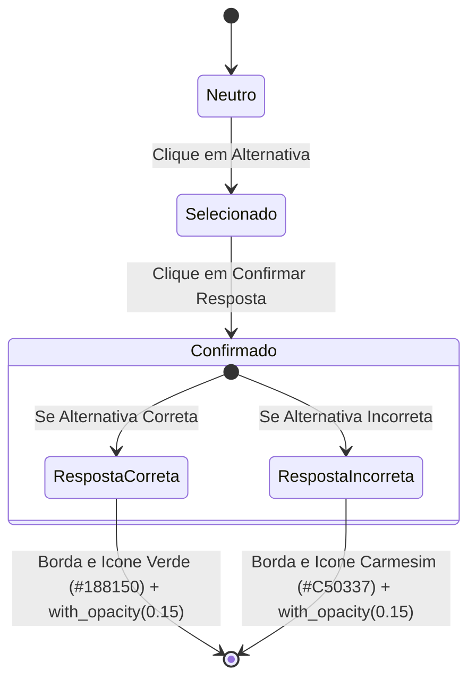

# Neuropedagogia, Gamificação e Ensino Implícito

**Conceito Relacionado:** [[Design_System_e_Tokens_Semanticos]] | [[Integracao_TTS_Typecast_e_Audio]] | [[Tipografia_Bilingue_e_CJK]]  
**Documentos Vinculados:** [[didactic_neuroscience_korean_ptbr]] | [[plano_ensino_implicito_neurociencia]] | [[viabilidade_app_coreano]] | [[viabilidade_sejong_companion]]  
**Bugs Catalogados:** [[bug_03_inversao_hex_alpha_aarrggbb_flet_flutter]]  

---

## 1. 🔬 Fundamentação Neurocientífica e Linguística Contrastiva

No **Saebom Companion (새봄 컴패니언)**, o ensino de coreano para falantes de Português Brasileiro — idioma distante que opera em ordem sintática **SOV (Sujeito + Objeto + Verbo)** e sistema de consoantes oclusivas tripartido — é estruturado para **reduzir a carga cognitiva extrínseca** e **substituir avisos por escrito por mecânicas sensoriais implícitas**.

```text
[ Estrutura Sintática PT-BR (L1) ]                 [ Estrutura Sintática Coreano (L2) ]
SVO: Maria (S) lê (V) o livro (O).               SOV: 마리아가 (S) 책을 (O) 읽습니다 (V).
Ordem direta: Sujeito -> Verbo -> Objeto         Ordem invertida: Sujeito -> Objeto -> Verbo
```

---

## 2. 🧬 Teoria Neurocientífica Aplicada

### A. Teoria da Carga Cognitiva (Sweller, 1988)
A memória de trabalho humana (*Working Memory*) suporta apenas 3 a 5 elementos (*chunks*) simultâneos. Banners explicativos extensos, disclaimers repetitivos e pop-ups de alerta consomem memória de trabalho (*Extraneous Cognitive Load*), prejudicando a absorção do conteúdo real (*Germane Load*).

### B. Teoria da Codificação Dupla (Paivio, 1986)
O processamento concomitante de estímulos visuais (grafia Hangul em **Pretendard** / formas geométricas de conectores e silhuetas de boca em `assets/mouth_shapes/`) e auditivos (áudio nativo HD via `AudioService`) cria traços de memória redundantes, fortalecendo a consolidação semântica.

### C. Memória Procedural vs. Declarativa na Linguagem (Ullman, 2004)
A gramática e a pronúncia fluentes dependem do **sistema procedural** (automático, inconsciente, nos gânglios da base). Romanizações ou regras textuais excessivas forçam o aluno a depender do **sistema declarativo**, criando a "muleta cognitiva" da tradução interna que trava a fala.

### D. Modelo Heurístico de Retenção Baseado em Meia-Vida
Modelo de decaimento temporal inspirado na curva exponencial de Ebbinghaus com meia-vida ($h \ge 0.2$ dias), multiplicadores diferenciados de recuperação ativa (`again`, `hard`, `good`, `easy`) e índice de fluência pelo tempo de resposta.

---

## 3. 🚫 A ABORDAGEM IMPLÍCITA: Física de Interações e Componentes Reais

Para substituir explicações textuais prolixas por aprendizagem experiencial dentro do sistema visual **Brand Book v3.1** (Midnight Navy `#02060F`, Violet `#8B4DFF`, Lilac `#B28AFF`, Gold `#FFAB22`, Cream `#F7F4EC`, Slate `#9EA2AE`), a pedagogia se materializa nos componentes da UI:

```text
┌────────────────────────────────────────────────────────────────────────────────────────┐
│                       MATRIZ DE SUBSTITUIÇÃO DO ENSINO IMPLÍCITO                       │
├─────────────────────────────────┬──────────────────────────────────────────────────────┤
│ Conceito Pedagógico             │ Mecânica Sensorial / Componente Implementado         │
├─────────────────────────────────┼──────────────────────────────────────────────────────┤
│ Abolição da Romanização         │ Gating áudio-visual (`HangulCard` + `mouth_shapes/`) │
│ Aspiração/Tensão (ㄱ/ㅋ/ㄲ)      │ Tripartição cromática (`OclusiveLab` + áudio HD)     │
│ Formação Silábica (C+V+받침)    │ Fábrica tátil (`SyllableFactory` na aba Sílabas)     │
│ Sintaxe SOV (Ordem Verbo)       │ Drag-and-Drop com rejeição elástica (`QuizWidget`)   │
│ Postposições Espaciais (위/아래)│ Diorama interativo (`SpatialStage` na Lição 03)      │
│ Numerais Sino vs Nativos        │ Discador interativo (`NumberTraining` 0–99)          │
│ Curva de Ebbinghaus             │ Orbes de vitalidade SRS na Home + fila `/review`     │
└─────────────────────────────────┴──────────────────────────────────────────────────────┘
```

### 1. Gating Áudio-Visual para Abolição da Romanização
O aplicativo segue a política estrita de **Zero Romanização** nas unidades curriculares. Ao interagir com uma letra ou palavra, o som nativo é disparado junto ao estímulo visual em Hangul, associando diretamente o fonema à forma gráfica sem caractere latino intermediário.

### 2. Drag-and-Drop Magnético de SOV (Física de Mola)
Ao montar frases em coreano no `QuizWidget`:
- Se o usuário arrasta o bloco para um papel sintático incompatível, o componente dispara alerta semântico e feedback elástico de devolução ao pool.
- O aluno internaliza a posição final do verbo/predicado e as cores dos papéis sintáticos (`ROLE_SUBJECT`, `ROLE_OBJECT`, `ROLE_VERB`, `ROLE_PARTICLE` em `src/theme.py`).

### 3. Encaixe Morfo-Fonético & Escrita Wongoji
A prática no **Wongoji Lab** (`CalligraphyWidget` e `WongojiMultiCellWidget`) e na `SyllableFactory` reforça a geometria dos blocos silábicos e o papel do *받침* por manipulação direta.

---

## 4. 🎮 Máquina de Estados do Quiz & Semântica de Feedback (Brand Book v3.1)

Para garantir que o erro seja tratado como calibração pedagógica e não como punição, a interface do quiz implementa uma **máquina de estados em 3 fases**:



> **Diretriz de UX (Brand Book v3.1):** O botão de avanço ("Próxima Pergunta") e a navegação estrutural permanecem no **Violeta Primário (`#8B4DFF` — `Colors.PRIMARY`)** com destaques de conquista e dicas em **Gold (`#FFAB22` — `Colors.ACCENT`)**, nunca sendo pintados de vermelho para evitar que o estudante associe a ação de continuar com o erro cometido.  
> *Nota Histórica:* Nas Rodadas 1–3 anteriores ao rebranding, utilizavam-se `#0356C5` / `#004C97` e `#19BD56` (substituído por `#188150` para atingir contraste WCAG AA de 4.89:1 e padronizado via `ft.Colors.with_opacity()` em vez de concatenação hex).

---

## 📌 Links de Navegação Obsidian
- 🧠 Central Mestre de Conceitos: [[INDICE_CONCEITOS]]
- 🧠 Estudo Didático Neuropedagógico: [[didactic_neuroscience_korean_ptbr]]
- 📋 Plano de Ensino Implícito: [[plano_ensino_implicito_neurociencia]]
- 🎨 Design System e Tokens: [[Design_System_e_Tokens_Semanticos]]
- 🚨 Bug das Cores de Quiz: [[bug_03_inversao_hex_alpha_aarrggbb_flet_flutter]]
