# 🗺️ Roadmap Mestre — Saebom Companion

**Status do Documento:** VIGENTE / BASELINE OFICIAL  
**Data de Atualização:** 2026-11-24  
**Versão Corrente (Release Branch):** `v0.3.9-alpha`  
**Documentos Vinculados:** [[decisao_arquitetural_motor_adaptativo_local_vs_llm]] | [[manifesto_estrategico_develop_vs_main]] | [[Motor_Adaptativo_e_Learning_Engine]] | [[CHANGELOG]] | [[relatorio_estado_atual_v0.3.8]]  

---

## 🧭 Visão Geral do Ciclo de Lançamentos

```mermaid
flowchart TD
    subgraph ALPHA["Fase Alpha (Motor, Segurança & Conteúdo Local)"]
        A1["🟢 v0.3.0-alpha<br/><b>Currículo 1A + Telemetria + Identidade</b><br/>• 11 Unidades 1A + Active Recall<br/>• 74 Testes Unitários (100% OK)"]
        A2["🔵 v0.3.1-alpha<br/><b>Expansão Curricular 1B + Admin Base</b><br/>• Livro Sejong Korean 1B (12 un.)<br/>• Portal /admin Base + 84 Testes"]
        A3["🟡 v0.3.2-alpha & v0.3.2-security<br/><b>Piloto OCI + Hardening P0/P1</b><br/>• Auth Fail-Closed + Recovery Key<br/>• data/cache/audio/ + silent.wav"]
        A4["🟣 v0.3.3–v0.3.5-alpha<br/><b>Wongoji Lab & Caligrafia Kyobo</b><br/>• Kyobo Handwriting 2025 + 51 Jamo<br/>• IoU Tolerante + Quiz 띄어쓰기"]
        A5["🌱 v0.3.6-alpha<br/><b>Rebranding v3.1 + Playwright + Neurociência</b><br/>• Saebom Companion (60/20/12/8)<br/>• 6 Módulos Neuro + BUG-11/BUG-12"]
        A6["🛡️ v0.3.7–v0.3.9-alpha (Atual)<br/><b>Mural, OWASP/MITRE & Estabilização</b><br/>• Notificações + Mural da Professora<br/>• Caddy/Docker Hardening + CI Playwright"]
        A7["🟠 v0.4.0-alpha (Meta Imediata)<br/><b>The Learning Engine</b><br/>• Pacote src/engine/ (R, M, C, K)<br/>• Learning Graph 1A/1B"]
        A8["🔷 v0.5.0-alpha<br/><b>Student Profile & Dashboard Cognitivo</b><br/>• Painel de Domínio do Aluno<br/>• Calibração sobre Telemetria Local"]
    end

    subgraph BETA["Fase Beta (Escalabilidade & Nuvem)"]
        B1["🟣 v0.6.0-beta<br/><b>Backend Persistente (PostgreSQL)</b><br/>• Sincronização Cloud Multi-device<br/>• Modo Offline-First"]
        B2["🏛️ v0.8.0-beta<br/><b>Teacher Companion Completo</b><br/>• Heatmap Coletivo & Agendamento<br/>• Evolução do Portal /admin Base"]
    end

    subgraph RELEASE["Fase de Produção"]
        R1["🚀 v1.0.0-GA<br/><b>Lançamento Público Oficial</b><br/>• Mobile, Web & Desktop Offline-First"]
    end

    A1 --> A2 --> A3 --> A4 --> A5 --> A6 --> A7 --> A8 --> B1 --> B2 --> R1
```

---

## 🟢 Fase 1: `v0.3.0-alpha` — Content & Memory Engine Baseline
> **Status:** CONCLUÍDO

### Entregáveis Concluídos:
- [x] **Currículo Integral Nível 1A:** 11 unidades didáticas JSON estruturadas (`unit_intro` + `unit_01` a `unit_10`), baseadas no material oficial *Sejong Korean 1A*.
- [x] **Arquitetura Data-Driven:** `DataService` genérico com validação via modelos Pydantic.
- [x] **Mecânica SOV com Validação Semântica:** Drag & Drop com papéis sintáticos e feedback elástico.
- [x] **Motor de Memória Temporal:** `MemoryNode` com modelo de meia-vida $R = 2^{-t/h}$.
- [x] **Dashboard de Active Recall & UX de Fila:** Rota `/review` com filtragem por threshold ($R < 75\%$) e estado proativo de "Revisão em Dia".
- [x] **Sistema de Evidência Pedagógica e Telemetria Local:** `TelemetryService`, `PedagogicalAnalyzer` e CLI `scripts/pedagogical_report.py` (100% anônimo e offline-first).
- [x] **Identidade Persistente do Aluno:** Suporte nativo a `client_storage` (`SharedPreferences` / `localStorage`) e export/import de backup JSON.
- [x] **Flashcards & Sentence Builder:** Módulo `/flashcards` com níveis de dificuldade e áudio HD.
- [x] **Suíte de Testes Automatizada:** 74 testes unitários com 100% de aprovação no `pytest`.

---

## 🔵 Fase 2: `v0.3.1-alpha` — Expansão Curricular: Livro 1B & Portal Docente Base
> **Status:** CONCLUÍDO  
> **Foco:** Inclusão do conteúdo didático oficial do livro *Sejong Korean 1B* / *Workbook 1B* (국립국어원) e entrega inicial do painel `/admin`.

### Entregáveis Concluídos:
- [x] **Estruturação dos Dados do Nível 1B:** 12 unidades JSON completas (`unit_1b_01` a `unit_1b_12`) baseadas na edição oficial do *King Sejong Institute 1B*.
- [x] **Inclusão dos Exercícios de Workbook 1B:** Questões de múltipla escolha, ordenação de palavras (`order_words`) e desafios sintáticos SOV Drag & Drop com papéis semânticos e rejeição elástica.
- [x] **Cadeia Contínua de Desbloqueio 1A → 1B:** Conexão contínua da `unit_10` para `unit_1b_01` até `unit_1b_12` no `ProgressService._UNLOCK_CHAIN`.
- [x] **Organização Visual na Home por Nível:** Seções visuais `Nível 1A · 한국어 1A` e `Nível 1B · 한국어 1B` com badges `B1`–`B12` e orbes de retenção SRS (em substituição à rotulagem legada de UI).
- [x] **Portal Pedagógico `/admin` (Base):** Login por PIN, compilação de KPIs da turma, diagnóstico de erros/abandono, roster pesquisável e exportação de relatórios Markdown.
- [x] **Expansão da Suíte de Testes:** `tests/test_unit_1b_content.py` e `tests/test_admin_service.py` adicionados, elevando a suíte para **84 testes com 100% de aprovação**.

---

## 🟡 Fase 3: `v0.3.2-alpha` & `v0.3.2-security` — Piloto Público, Hardening P0/P1 & Segurança
> **Status:** CONCLUÍDO  
> **Foco:** Validação em produção com turmas reais, onboarding nominal, estabilidade de persistência, isolamento de storage e fechamento dos bloqueadores de segurança.

### Entregáveis Concluídos:
- [x] **Auditoria Global de Conteúdo (23 Unidades):** Script CLI `scripts/audit_curriculum.py` e suíte `tests/test_curriculum_integrity.py` validando schemas Pydantic, Zero Romanização, unicidade de IDs e consistência semântica SOV.
- [x] **Onboarding e Identificação Nominal do Aluno:** Tela institucional acolhedora vinculando Nome/Sobrenome a um Student ID público com restauração segura de progresso.
- [x] **Persistência Real Multiplataforma (`ft.SharedPreferences`):** Sincronização assíncrona com `localStorage` e arquivos JSON persistentes no servidor.
- [x] **Deploy 24/7 na Oracle Cloud Infrastructure:** Container Docker multi-arch com Caddy reverse proxy e HTTPS automático no domínio oficial **`saebomcompanion.duckdns.org`** (substituindo o domínio legado do piloto inicial).
- [x] **Hardening de Armazenamento & Auto-Recuperação:** Proteção contra sessões corrompidas (`.corrupt.bak`) e clamping de meia-vida (`half_life >= 0.2`) no `ProgressService` e `MemoryNode`.
- [x] **Áudio Web & Catalogação `BUG-08`:** Inclusão de `assets/silent.wav` para destravar autoplay em navegadores.
- [x] **Hardening de Segurança `v0.3.2-security` (`BUG-09`):** Eliminação de PIN padrão (postura fail-closed via `ADMIN_PIN`), comparação em tempo constante (`hmac.compare_digest`), lockouts progressivos (5 falhas → 30s; 10 falhas → 5 min), tokens efêmeros, desacoplamento entre `student_id` público e chave secreta de recuperação (salted SHA-256), isolamento de `data/cache/audio/` fora de `assets/` read-only, rotação de telemetria (`MAX_EVENTS_PER_FILE = 5000`), proteção no `.gitignore` e pipeline inicial no GitHub Actions (106 testes).

---

## 🟣 Fase 3B: `v0.3.3-alpha` a `v0.3.5-alpha` — Wongoji Lab, Caligrafia Kyobo & IoU Tolerante
> **Status:** CONCLUÍDO  
> **Foco:** Motor tátil de caligrafia coreana alinhado aos gabaritos oficiais dos *Workbooks 1A e 1B*.

### Entregáveis Concluídos:
- [x] **Grade 원고지 (Wongoji) & Decomposição Unicode (`v0.3.3`–`v0.3.4`):** `src/jamo_utils.py`, catálogo completo de 51 jamo KS X 1001 (`assets/stroke_order/jamo_strokes.json`), `CalligraphyWidget` com avaliação Bitmap IoU 48×48 e overlay diagnóstico em 3 canais (verde/vermelho/cinza).
- [x] **Wongoji Focus Mode & Caligrafia Kyobo (`v0.3.5`, `BUG-10`):** Modal dedicado (`ft.AlertDialog`) isolando o desenho da disputa na Gesture Arena do scroll, integração da fonte manuscrita oficial **Kyobo Handwriting 2025** (`assets/fonts/KyoboHandwriting2025lyb.otf`, escala `0.68`) e IoU tolerante (`calculate_tolerant_iou`) com dilatação morfológica.
- [x] **Caligrafia Multi-Célula no Quiz (`WongojiMultiCellWidget`):** Suporte a palavras e expressões com espaçamento coreano (*띄어쓰기* em células `␣`), 23 questões `calligraphy` derivadas dos gabaritos oficiais 1A/1B e submissão explícita pelo botão **"✅ Terminei"** (161 testes).

---

## 🌱 Fase 3C: `v0.3.6-alpha` — Rebranding Saebom v3.1, Playwright E2E & Neurociência
> **Status:** CONCLUÍDO  
> **Foco:** Transição institucional completa para **Saebom Companion (새봄 컴패니언)**, blindagem Web/CanvasKit e reconciliação dos módulos sensoriais.

### Entregáveis Concluídos:
- [x] **Rebranding Integral & Brand Book v3.1:** Adoção da hierarquia cromática **60/20/12/8** (Midnight Navy `#02060F`, Cream `#F7F4EC`, Slate `#9EA2AE`, Violet `#8B4DFF`, Gold `#FFAB22`, Lilac `#B28AFF`), expurgo de cores legadas (`#004C97`/`#0356C5`/`#F5A623`), geração determinística dos 21 assets em `assets/branding/` e publicação do [`MANUAL_DE_IDENTIDADE_SAEBOM.md`](../Design_e_Branding/MANUAL_DE_IDENTIDADE_SAEBOM.md).
- [x] **Prevenção de Tela Preta Flutter Web (`BUG-11`):** Prefixos `/` em `ft.Image(src=...)`, transição atômica de `page.views` no `Router` com `render_route`, timeout em `SharedPreferences.get` e preservação de deep links.
- [x] **Suíte Playwright Chromium & `BUG-12`:** Testes E2E em navegador real (`tests/test_playwright_e2e.py`) e correção de deadlock de pipe anônimo no Windows via `subprocess.DEVNULL`.
- [x] **Reconciliação de Neurociência & `WhatsNewDialog`:** Integração de 6 módulos (`SyllableFactory`, `SpatialStage`, `NumberTraining`, `AirParticleEffect`, `HapticService`, `TaskUtils`) + `OclusiveLab` + 11 SVGs anatômicos/espaciais, `WhatsNewDialog` com `data/release_notes.json` e `StudentIdentity` com normalização PascalCase e fusão atômica (300+ testes).

---

## 🛡️ Fase 3D: `v0.3.7-alpha` a `v0.3.9-alpha` — Mural Docente, Hardening OWASP/MITRE & Estabilização
> **Status:** CONCLUÍDO / EM FECHAMENTO DE RELEASE (`fix/v0.3.9-hardening-and-cleanup`)  
> **Foco:** Comunicação em tempo real professora-turma, blindagem OWASP Top 10 / MITRE ATT&CK em infraestrutura, resolução de pendências de runtime (`BUG-13`) e CI Playwright.

### Entregáveis Concluídos:
- [x] **Ecossistema de Notificações & Mural da Professora (`v0.3.7`):** `NotificationService` (Web Notification API com guard `page.web` + fallback `SnackBar`), `AnnouncementService` com barramento `page.pubsub`, 3ª aba "Mural de Avisos" em `/admin`, soft prompt e badges dourados na Home, além do desbloqueio do campo de PIN administrativo (`c7aa16e`).
- [x] **Hardening OWASP/MITRE & Ativação Visual (`v0.3.8`):** `.dockerignore`, `Dockerfile` com usuário não-privilegiado `saebomuser` (UID/GID `10001`), `docker-compose.yml` com `no-new-privileges:true`, cabeçalhos defensivos no `Caddyfile`, trilha `security_audit` Zero-PII, limites `MAX_*` + remoção de `\x00` em `AnnouncementService`, montagem de `SyllableFactory` e `NumberTraining` em `/hangul` e de `SpatialStage` na Lição 03, e catalogação detalhada do [`BUG-13`](../Bugs_Criticos/bug_13_hardening_owasp_mitre_container_caddy_auditoria.md) (459 testes + 21 subtestes).
- [x] **Fechamento `v0.3.9-alpha` (Hardening de Runtime, P0/P1 & CI Playwright):**
  - Separação `:80` (redirect HTTPS) vs `:443` `saebomcompanion.duckdns.org` (HSTS exclusivo em HTTPS + CSP completa para CanvasKit/Skwasm) no `Caddyfile`.
  - Named volumes Docker e `SAEBOM_ANNOUNCEMENTS_PATH` compatíveis com `saebomuser` (`10001`), `SAEBOM_ADMIN_PIN:?` fail-closed e remoção da porta `8554` do `scripts/setup_oci_server.sh`.
  - Remoção de `"세"`/`"종"` em `hangul_view.py`, fontes 100% locais em `src/theme.py` (`Pretendard` + `Kyobo Handwriting 2025`), isolamento de `client_key` e exclusão de `security_audit` dos KPIs pedagógicos no `/admin`.
  - Conclusão funcional de `SpatialStage`, `NumberTraining` (0–99 nativo e botão `OK`), reprodução Web via bytes em `data/cache/audio/` no `AudioService`, unificação de `ProgressService.set_student_name`, persistência atômica em `AnnouncementService` e timeouts em `SharedPreferences.set`.
  - Pipeline GitHub Actions renomeado para Saebom Companion com job `e2e-playwright` dedicado em Chromium.

---

## 🟠 Fase 4: `v0.4.0-alpha` — The Learning Engine
> **Status:** PLANEJADO (Próxima Meta Imediata)  
> **Foco:** Implementação da IA Simbólica / Cognitiva Local conforme [[decisao_arquitetural_motor_adaptativo_local_vs_llm]].

### Objetivos & Entregáveis Detalhados:
1. **Criação do Pacote `src/engine/` (ainda não criado em `src/`):**
   - `src/engine/retention.py` — Curva de decaimento temporal $R(t)$ e atualização de meia-vida.
   - `src/engine/mastery.py` — Algoritmo de domínio cumulativo por média móvel exponencial ($M$).
   - `src/engine/confidence.py` — Índice de fluência motora calibrado pelo tempo de resposta ($C$).
   - `src/engine/scheduler.py` — Agendador priorizado de revisões ativas.
   - `src/engine/recommender.py` — Árvore de decisão determinística (*O que estudar agora?*).
   - `src/engine/graph.py` — Grafo de dependência curricular dos Níveis 1A e 1B (baseado nos livros *Sejong Korean 1A e 1B*).
2. **Desacoplamento Arquitetural:**
   - Migrar cálculos matemáticos hoje concentrados em `MemoryNode` (`src/models.py`) e `ProgressService` (`src/services.py`) para a camada `src/engine/`.
   - As views do Flet passam a consumir apenas as recomendações da facade `LearningEngine`.
3. **Mapeamento do Learning Graph (Níveis 1A e 1B):**
   - Decomposição das unidades em nós atômicos (Vogais, Consoantes, *받침*, Partículas `은/는`, `이/가`, `을/를`, `에/에서`, Cópula `이에요/예요`, conectivos `-아서/어서`, futuro `-(으)ㄹ 거예요`, etc.).
   - Rastreamento da causa raiz de erros sintáticos, fonológicos e caligráficos.

### Critério de Aceite:
- Módulo `src/engine/` com cobertura de testes unitários superior a 95%.
- Recomendador emitindo ações explicáveis (`LEARN_NEW`, `ACTIVE_RECALL`, `TARGETED_DRILL`, `FLUENCY_BOOST`).

---

## 🔵 Fase 5: `v0.5.0-alpha` — Student Profile & Dashboard Cognitivo
> **Status:** PARCIALMENTE INICIADO (Telemetria Local Entregue) / EVOLUÇÃO PLANEJADA  
> **Foco:** Consolidação do perfil cognitivo individual do estudante e visualização gráfica das 4 métricas na interface do aluno.

### Estado Real & Entregáveis:
1. **Telemetria Pedagógica Local / Anônima (`[x]` Já Entregue em `v0.3.0-alpha`):**
   - `TelemetryService` (`data/telemetry/events_*.jsonl` append-only Zero-PII com rotação a cada 5.000 eventos) e `PedagogicalAnalyzer` já estão ativos e em produção.
2. **Student Profile Model (`[ ]` Pendente):**
   - Estrutura consolidada registrando forças, fraquezas conceituais por nó do grafo, velocidade média de resposta e padrões de estudo para calibração estatística dos pesos de meia-vida.
3. **Dashboard de Domínio Cognitivo do Aluno (`[ ]` Pendente):**
   - Visualização gráfica das 4 métricas (*Completion, Mastery, Retention, Confidence*) acessível diretamente ao estudante (hoje os KPIs consolidados existem apenas no Portal `/admin`).
4. **Fechamento de Pendências Sensoriais:**
   - Integração ou descarte deliberado dos utilitários hoje desconectados na UI (`AirParticleEffect`, `HapticService`, `jamo_utils.layout_syllable_strokes`).

---

## 🟣 Fase 6: `v0.6.0-beta` — Persistent Backend & Multi-User
> **Status:** PLANEJADO  
> **Foco:** Transição de sessão local em JSON para contas persistentes em nuvem com sincronização multi-dispositivo.

### Objetivos & Entregáveis Detalhados:
1. **Banco de Dados Relacional (PostgreSQL):**
   - Migração de `data/sessions/student_*.json` para persistência relacional robusta em nuvem (mantendo compatibilidade de importação).
2. **Autenticação e Sincronização Bidirecional Offline-First:**
   - Login seguro entre navegador Web, desktop e dispositivos móveis sem perda de progresso offline.
3. **Deploy em Produção (PWA + Mobile):**
   - Infraestrutura cloud consolidada na OCI Ampere A1 com banco gerenciado/containerizado e backups automatizados.

---

## 🔴 Fase 7: `v0.8.0-beta` — Teacher Companion Completo (CCCB)
> **Status:** PARCIALMENTE ENTREGUE (Base `/admin` Ativa) / EVOLUÇÃO PLANEJADA  
> **Foco:** Evoluir o Portal `/admin` já operacional para uma suíte docente completa integrada ao backend multi-usuário.

### Estado Real & Entregáveis:
1. **Base do Portal `/admin` (`[x]` Já Entregue em `v0.3.1`–`v0.3.9`):**
   - Autenticação fail-closed por PIN com rate limiting e auditoria Zero-PII, KPIs globais, questões com maior taxa de erro, funil de abandono, vocabulário crítico, roster pesquisável, exportação Markdown (`data/reports/`) e Mural de Avisos da Professora em tempo real (`AnnouncementService` + `page.pubsub`).
2. **Heatmap Docente & Agendamento Pedagógico (`[ ]` Pendente):**
   - Mapa de calor coletivo por unidade, partícula e jamo sobre dados multi-usuário sincronizados.
   - Agendamento programado de avisos e trilhas de revisão recomendadas antes das aulas presenciais no CCCB.

---

## 🏆 Fase 8: `v1.0.0-GA` — General Availability
> **Status:** PLANEJADO  
> **Foco:** Lançamento público oficial multiplataforma.

### Critérios Finais:
- 100% do currículo **Nível 1A e Nível 1B** (baseado nos livros didáticos oficiais *Sejong Korean 1A e 1B*) validado por alunos reais do CCCB.
- Zero bugs críticos de layout, áudio, caligrafia, segurança ou persistência.
- Empacotamento e distribuição estável em Web/PWA, Android, iOS e Desktop offline-first.
