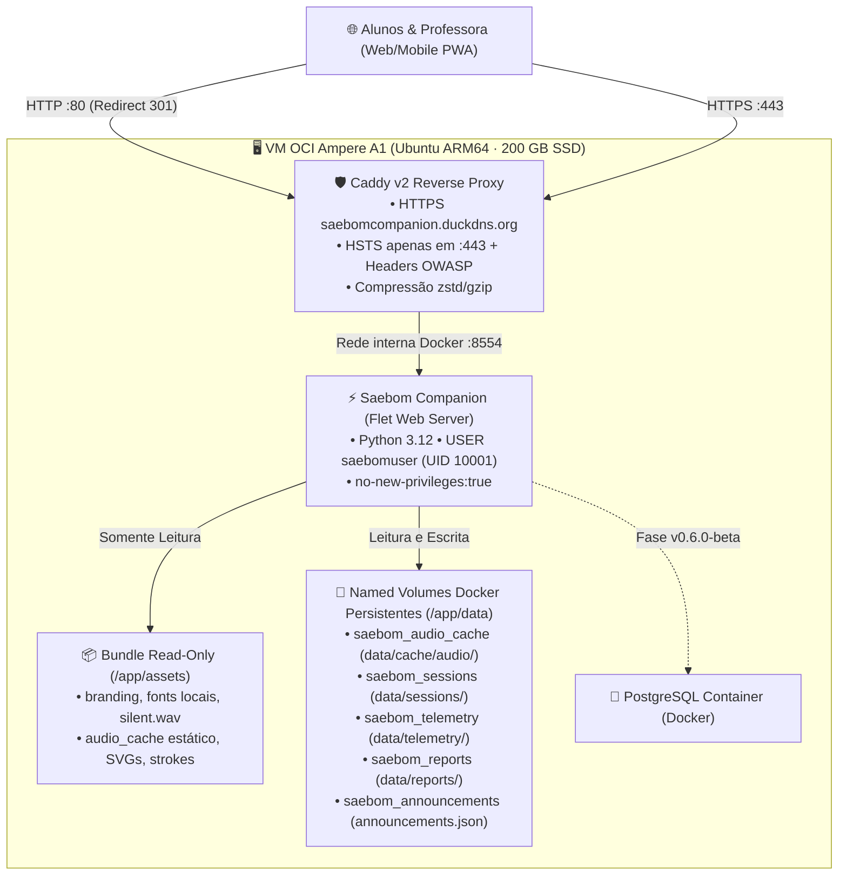

# ☁️ Estratégia de Hospedagem: Oracle Cloud Always Free (ARM Ampere) vs. Render

**Status do Documento:** VIGENTE / ARQUITETURA DE DEPLOY  
**Data de Atualização:** 2026-11-24  
**Contexto:** Definição da infraestrutura de hospedagem em nuvem para a versão Web/PWA do **Saebom Companion (새봄 컴패니언)** em `https://saebomcompanion.duckdns.org`, preparação para o backend de sincronização (`v0.6.0-beta`) e operação contínua do Portal Pedagógico `/admin`.  

---

## 1. Comparativo Técnico de Infraestrutura Gratuita

| Recurso / Critério | Render (Free Tier Web Service) | Oracle Cloud Infrastructure (OCI Always Free ARM Ampere) | Impacto no Saebom Companion |
| :--- | :--- | :--- | :--- |
| **Arquitetura & CPU** | 0.1 vCPU compartilhada | **Até 4 OCPUs (ARM64 Ampere A1)** *(ou 2 OCPUs dedicadas por VM)* | Inicialização instantânea do runtime Flet/Python e recálculo ágil dos nós SRS e bitmaps IoU. |
| **Memória RAM** | 512 MB | **Até 24 GB de RAM** *(ou 12 GB por VM)* | Capacidade para suportar dezenas de conexões concorrentes de alunos, WebSockets e síntese/IoU sem OOM (*Out of Memory*). |
| **Armazenamento** | Efêmero (apagado no reinício) | **200 GB Block Storage Persistente** | **Crítico:** Preserva em volumes nomeados Docker os áudios sintetizados (`data/cache/audio/`), sessões (`data/sessions/`), logs (`data/telemetry/`), relatórios (`data/reports/`) e mural (`data/announcements/`). |
| **Disponibilidade / Uptime** | Hiberna após 15 min de inatividade | **24/7 Always-On (Sem hibernação)** | Elimina o *cold start* de 50–90s do Render. Alunos e professora acessam instantaneamente. |
| **Limite Mensal de Horas** | 750 horas/mês (1 instância) | **Ilimitado (Gratuito para sempre)** | Permite manter o servidor ativo 30 dias por mês ininterruptamente. |
| **Tráfego de Saída** | 100 GB/mês | **10 TB/mês** | Margem ampla para entrega do bundle CanvasKit e streaming de áudios fonéticos coreanos sem custo adicional. |
| **Controle de Sistema Operacional** | PaaS fechado (Docker container) | **VPS Linux Dedicado (Ubuntu ARM64)** | Liberdade para configurar Caddy v2 com TLS automático, Docker Compose com *named volumes*, firewall restrito (`80`/`443`) e futuro PostgreSQL. |

---

## 2. Por que o OCI Always Free é a Escolha Ideal para o Saebom Companion?

### 1. Isolamento Estrito `assets/` (Read-Only) vs. `data/` (Mutável em Named Volumes)
No Render gratuito, reinicializações apagam arquivos locais. Na arquitetura vigente do **Saebom Companion**, o armazenamento segue separação rígida de segurança:
- **`assets/` (estritamente Read-Only no bundle):** Contém os assets estáticos pré-empacotados na imagem (`assets/branding/`, `assets/fonts/` locais com `Pretendard` e `Kyobo Handwriting 2025`, `assets/silent.wav`, `assets/mouth_shapes/`, `assets/spatial/`, `assets/stroke_order/` e o pacote pré-aquecido `assets/audio_cache/`). O processo em runtime **nunca** escreve em `assets/`.
- **`data/` (Named Volumes Docker persistentes graváveis pelo `saebomuser`, UID `10001`):**
  - Cache dinâmico de áudios sintetizados em runtime (`data/cache/audio/` → volume `saebom_audio_cache`)
  - Sessões de alunos (`data/sessions/student_*.json` → volume `saebom_sessions`)
  - Telemetria Zero-PII e eventos `security_audit` (`data/telemetry/events_*.jsonl` → volume `saebom_telemetry`)
  - Relatórios exportados do `/admin` (`data/reports/*.md` → volume `saebom_reports`)
  - Mural de avisos da professora (`SAEBOM_ANNOUNCEMENTS_PATH=/app/data/announcements/announcements.json` → volume `saebom_announcements`)

A adoção de **named volumes Docker** (em substituição a bind mounts diretos no host) evita conflitos de permissão Linux (`PermissionError` / `EBUSY` em arquivo único) com o usuário não-privilegiado **`saebomuser` (UID/GID `10001:10001`)** definido no `Dockerfile` (OWASP A05 / MITRE T1068 & T1611).

### 2. Zero Cold Start para Alunos e Professora
No plano gratuito do Render, quando a professora abre o painel `/admin` ou um aluno acessa o link durante a aula no CCCB, o container leva de 50 a 90 segundos para acordar. Na OCI, a aplicação executa continuamente via Docker Compose (`restart: always`) atrás do proxy Caddy.

### 3. Suporte Nativo a ARM64 (Ampere) e Segurança de Borda
O ecossistema Python 3.12, Flet 0.85.3, Pillow e Flutter Web possui suporte pleno em ARM64 (`aarch64`). O proxy Caddy isola a porta interna `8554` (`expose: ["8554"]`, sem publicação no host nem regra de firewall externa para `8554`), expondo apenas HTTP `:80` (com redirect permanente para HTTPS) e HTTPS `:443` com cabeçalhos OWASP (HSTS exclusivo em HTTPS, CSP ajustada para CanvasKit/Skwasm, `X-Frame-Options: DENY`, `X-Content-Type-Options: nosniff` e supressão de `Server`).

---

## 3. Arquitetura de Deploy na OCI (`saebomcompanion.duckdns.org`)

---

## 4. Roteiro de Provisionamento OCI (Guia Rápido)

1. **Criar Conta no Oracle Cloud Free Tier:**
   - Selecionar a Home Region mais próxima (ex.: `São Paulo - Brazil East` ou `Ashburn - US East`).
2. **Provisionar Instância Compute `VM.Standard.A1.Flex`:**
   - Imagem: `Ubuntu 24.04 LTS (AArch64)`.
   - OCPUs: 2 a 4 · Memória: 12 GB a 24 GB · Disco de Inicialização: 100 GB a 200 GB.
3. **Configurar Security List (VCN) e Firewall (`iptables`):**
   - Liberar **exclusivamente** as portas Ingress `80 (HTTP)` e `443 (HTTPS)` (além de `22` para administração SSH).
   - **Nunca** abrir a porta `8554` publicamente — o tráfego externo deve passar exclusivamente pelo Caddy.
4. **Provisionar `.env` e Subir Containers (`scripts/setup_oci_server.sh`):**
   - Definir obrigatoriamente `SAEBOM_ADMIN_PIN` no `.env` (postura *fail-closed* exigida por `docker-compose.yml` via `${SAEBOM_ADMIN_PIN:?...}`) e opcionalmente `TYPECAST_API_KEY`.
   - Executar `docker compose up -d --build`, garantindo criação automática dos named volumes com permissões compatíveis para o `saebomuser` (UID `10001`).
5. **Configurar Domínio & SSL:**
   - Apontar o DNS DuckDNS para o IP público reservado da instância: **`saebomcompanion.duckdns.org`**, com TLS automático gerenciado pelo `Caddyfile`.
